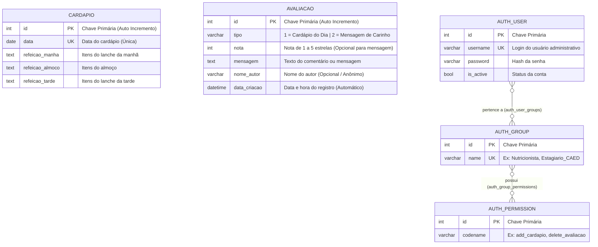

# 🗄️ DER e Dicionário de Dados — IFome

Este documento descreve a modelagem relacional e a estrutura física das tabelas utilizadas pelo sistema **IFome** no banco de dados (`SQLite`).

---

## 1. Diagrama Entidade-Relacionamento (DER)

O sistema opera com duas entidades principais de domínio (`cardapio_cardapio` e `avaliacoes_avaliacao`), completamente desacopladas para permitir que estudantes enviem avaliações e mensagens de carinho livremente sem dependência de chave estrangeira obrigatória, além das entidades nativas do sistema de autenticação e controle de permissões do Django (`auth_user`, `auth_group` e `auth_permission`).

---

## 2. Dicionário de Dados

### 2.1. Tabela `cardapio_cardapio` (App: `cardapio` / Model: `Cardapio`)
Armazena as refeições diárias servidas no refeitório do campus. Possui restrição de unicidade na data para impedir duplicidade de cardápios no mesmo dia[cite: 1].

| Campo | Tipo no Django | Tipo no Banco | Nulo? | Chave / Restrição | Descrição |
| :--- | :--- | :--- | :---: | :--- | :--- |
| `id` | `BigAutoField` | `INTEGER` | Não | `PRIMARY KEY` | Identificador único gerado automaticamente. |
| `data` | `DateField` | `DATE` | Não | `UNIQUE` | Data de referência do cardápio (um registro por dia)[cite: 1]. |
| `refeicao_manha` | `TextField` | `TEXT` | Não | — | Descrição dos alimentos servidos no lanche da manhã[cite: 1]. |
| `refeicao_almoco` | `TextField` | `TEXT` | Não | — | Descrição dos alimentos servidos no almoço[cite: 1]. |
| `refeicao_tarde` | `TextField` | `TEXT` | Não | — | Descrição dos alimentos servidos no lanche da tarde[cite: 1]. |

---

### 2.2. Tabela `avaliacoes_avaliacao` (App: `avaliacoes` / Model: `Avaliacao`)
Armazena tanto as avaliações quantitativas/qualitativas sobre o cardápio quanto as mensagens de carinho direcionadas à equipe da cozinha[cite: 1].

| Campo | Tipo no Django | Tipo no Banco | Nulo? | Chave / Restrição | Descrição |
| :--- | :--- | :--- | :---: | :--- | :--- |
| `id` | `BigAutoField` | `INTEGER` | Não | `PRIMARY KEY` | Identificador único gerado automaticamente. |
| `tipo` | `CharField(1)` | `VARCHAR(1)` | Não | `CHOICES ('1', '2')` | Classifica o registro: `'1'` para Avaliação do Cardápio e `'2'` para Mensagem de Carinho[cite: 1]. |
| `nota` | `IntegerField` | `INTEGER` | Sim | `1 <= nota <= 5` | Avaliação de 1 a 5 estrelas (preenchida quando `tipo = '1'`)[cite: 1]. |
| `mensagem` | `TextField` | `TEXT` | Sim | — | Comentário sobre a refeição ou texto da mensagem de carinho[cite: 1]. |
| `nome_autor` | `CharField(100)` | `VARCHAR(100)` | Sim | — | Nome informado pelo estudante/servidor (opcional; exibido como anônimo se vazio)[cite: 1]. |
| `data_criacao` | `DateTimeField` | `DATETIME` | Não | `auto_now_add=True` | Data e hora exatas em que a avaliação foi enviada[cite: 1]. |

---

### 2.3. Tabelas de Autenticação e Autorização (`django.contrib.auth`)
Gerenciadas nativamente pelo Django e configuradas automaticamente pelo comando `python manage.py configurar_perfis`[cite: 1]:

* **`auth_user`:** Armazena os usuários que possuem acesso à área administrativa (`nutri_teste`, `estagiario_teste` e superusuários)[cite: 1].
* **`auth_group`:** Define os perfis de acesso do sistema (`Nutricionista` e `Estagiario_CAED`)[cite: 1].
* **`auth_group_permissions`:** Vincula cada grupo às permissões específicas dos modelos `Cardapio` (`view_cardapio`, `add_cardapio`, `change_cardapio`, `delete_cardapio`) e `Avaliacao` (`view_avaliacao`, `delete_avaliacao`)[cite: 1].